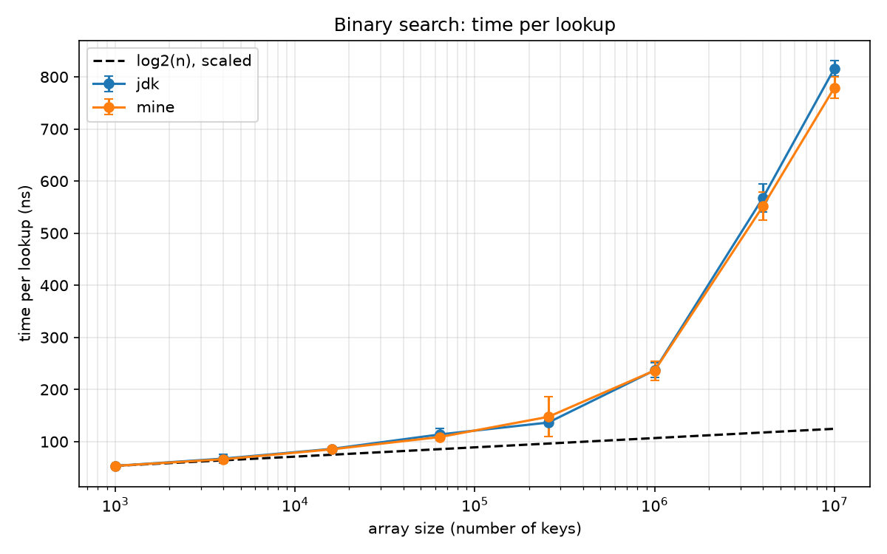
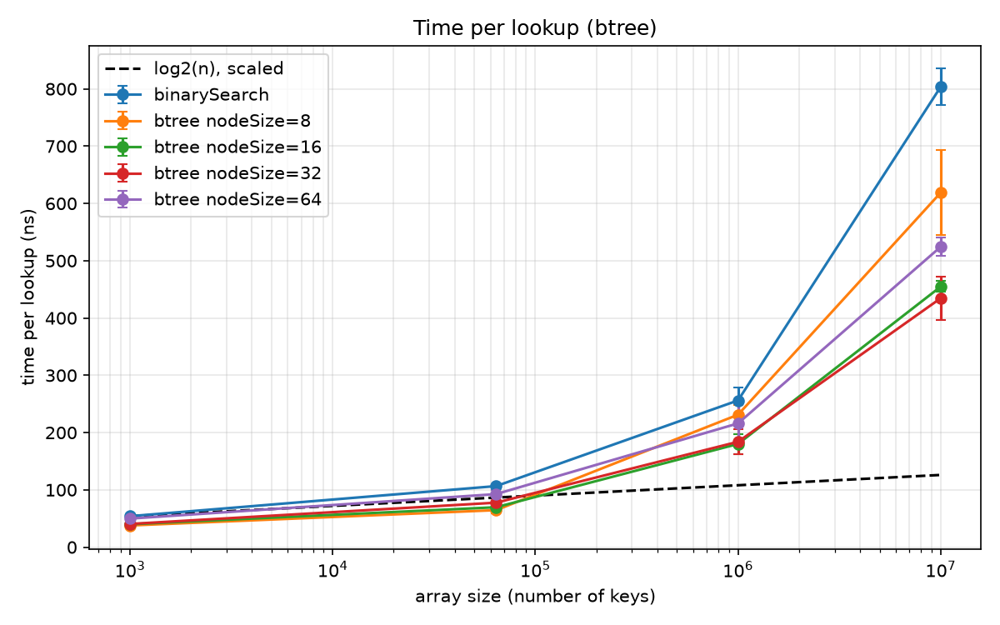

# learned-index

**Question:** Can a learned model replace a B-tree for lookups in a sorted array? And for which data does it fail?

Based on Kraska et al., *The Case for Learned Index Structures* (SIGMOD 2018). This project builds a binary search, a B-tree and a learned index in Java, measures them, and looks for the cases where the learned index breaks.

## Results so far

**Step 1, binary search (2026-11-04):** O(log n) only matches reality while the array fits in the cache. From 1,000 to 10 million keys the search needs 2.3× more steps but takes 12.6× more time (52 → 653 ns). The measurement is still noisy, details in `EXPERIMENTS.md`.

**Step 2, reliable measurements (2026-11-04):** Pinning the benchmark to a fast core made the noise *worse*. Pinning it to two slow but quiet cores fixed it: two versions of the same algorithm now agree within 3% on average instead of 39%. All benchmarks now run with `bench\run-pinned.cmd`.



**Step 3, B-tree (2026-11-04):** A read-only B-tree beats binary search at every size, by 1.8× at 10 million keys (435 vs. 804 ns). The best node size depends on the array: 8 keys (one cache line) for small arrays, but 16–32 keys for big ones, because fewer levels mean fewer trips to RAM.



## Plan

1. Binary search as baseline: done
2. Make the measurements reliable: done
3. B-tree with different node sizes: done
4. Learned index: one line, then many lines (piecewise linear): next
5. Comparison on evenly spread keys: time and memory
6. Data that breaks the learned index
7. Write-up

## Reproduce

Needs JDK 25 or newer, Maven, Python 3.

```
mvn package
bench\run-pinned.cmd BinarySearchBench -rf csv -rff bench/binary-search-ecores.csv
python -m venv .venv
.venv\Scripts\pip install -r analysis/requirements.txt
.venv\Scripts\python analysis/plot.py bench/binary-search-ecores.csv
```

Tests also run in Eclipse: File → Import → Maven → Existing Maven Projects, then right-click the project → Run As → JUnit Test.

## Limitations

- Measured on one laptop (Intel Core Ultra 5 125U, Windows 11). Other machines will give other numbers.
- Only 64-bit integer keys, read-only (no inserts).
