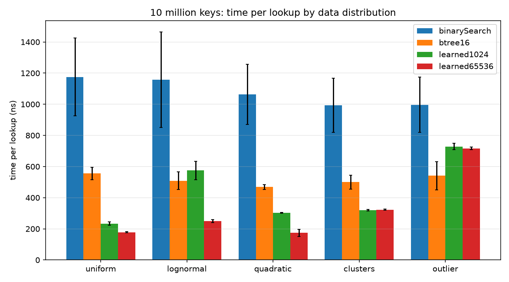
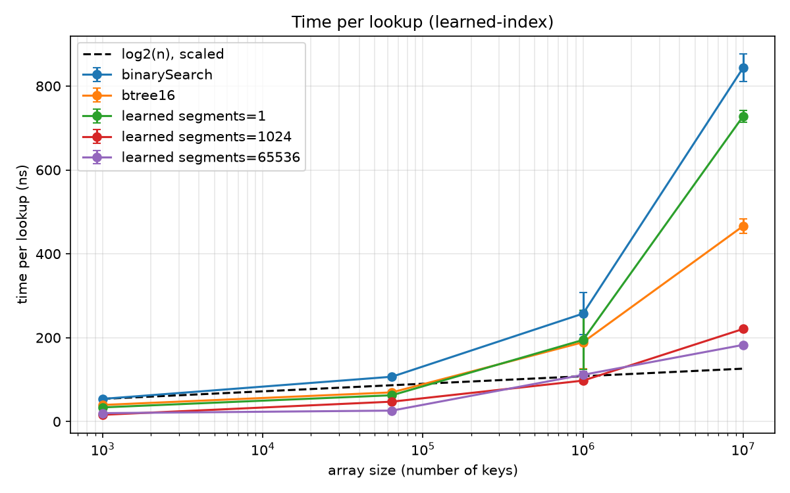
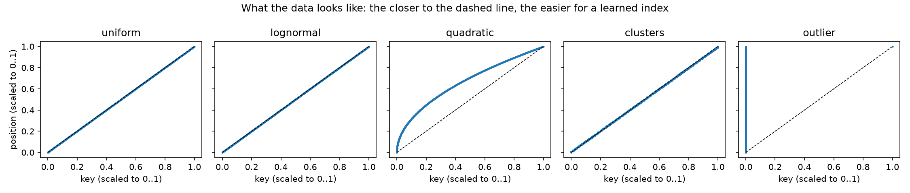

# learned-index

**Can a learned model replace a B-tree for lookups in a sorted array? And for which data does it fail?**

In 2018, Kraska et al. (*The Case for Learned Index Structures*, SIGMOD) suggested replacing classic index structures with models that *predict* where a key is. I built a binary search, a B-tree and a learned index in Java, measured them on 10 million keys, and then looked for data that breaks the learned index.



## Short version

- **On friendly data the learned index wins clearly.** With evenly spread keys it needs 183 ns per lookup, the B-tree 466 ns, binary search 844 ns.
- **The B-tree doesn't care about the data.** On five very different distributions it always takes about 470–560 ns.
- **One single key can break the learned index.** One huge key in 10 million pulls its root line off, only 2 of 65,536 segments get used, and it becomes slower than the B-tree.

## What's in here

| structure | idea | file |
|---|---|---|
| binary search | halve the range until the key is found | `BinarySearch.java` |
| B-tree | read-only B+ tree without pointers, one level = one array | `StaticBTree.java` |
| learned index | a root line picks a segment, the segment's line predicts the position, then binary search in a small window | `LearnedIndex.java` |

Every structure is tested against the JDK's `Arrays.binarySearch`, also on all five data distributions (70 tests). The learned index always finds every key, even on bad data: bad lines only make its search window bigger, never wrong.

## Results, step by step

Full details, numbers and failed ideas are in [`EXPERIMENTS.md`](EXPERIMENTS.md).

**1. Binary search.** O(log n) only matches reality while the array fits in the cache. From 1,000 to 10 million keys the search needs 2.3× more steps but takes 12.6× more time, because the last steps of every search go to RAM.

**2. Reliable measurements.** My first measurements were too noisy to compare anything: two versions of the same algorithm differed by up to 2×. Pinning the benchmark to a *fast* core made it worse, pinning it to two *slow* but quiet cores fixed it (difference down to 3% on average). My explanation: the apps I was using ran on the fast cores.


**3. B-tree.** Faster than binary search at every size, 1.8× at 10 million keys. The textbook says one node should be one cache line (8 keys). That is true for small arrays, but for big ones 16–32 keys per node are better: fewer levels means fewer trips to RAM.


**4. Learned index.** One line is not enough (728 ns at 10 million keys): it is off by ~1,900 positions on average, and searching that window costs exactly the expensive steps. With 65,536 lines it takes 183 ns, 2.5× faster than the B-tree, with less extra memory (1.5 MB vs. 5.1 MB). But the model itself has to fit in the cache: at 1 million keys, 1,024 lines (24 KB) beat 65,536.



**6. Breaking it.** Five kinds of data with 10 million keys each:



| data | B-tree 16 | learned, 65,536 lines | segments actually used |
|---|---|---|---|
| uniform | 556 ns | **178 ns** | 65,536 |
| lognormal | 508 ns | **250 ns** | 63,780 |
| quadratic | 469 ns | **175 ns** | 53,249 |
| 100 clusters | 500 ns | **323 ns** | 100 |
| one outlier | **541 ns** | 717 ns | 2 |

(Step 5, "comparison on evenly spread keys", turned out to be covered by step 4.)

## What I learned

- **Counting steps is not enough.** Where the data sits (cache or RAM) decided almost every result in this project, more than the number of steps.
- **The learned index has two weak spots, not one.** Each segment's keys have to be close to a line, *and* the root line has to spread the keys over the segments. The outlier and the clusters attack the second one. The root is a least-squares line, and least squares is very sensitive to extreme values.
- **The B-tree's worst case is its best case.** The learned index can be 3× faster or 1.3× slower than the B-tree, depending on data you might not control.
- **Measure the measurement first.** Without the check "two versions of the same algorithm must be equally fast", I would have trusted numbers that were off by 2×.

## Open questions

- Quadratic data has an average search window of 467 keys and is still as fast as uniform data with a window of 9. I can't explain this yet.
- Two explanations in step 3 are not tested: whether the CPU fetches cache lines in pairs, and whether Java's 16-byte array header makes 8-key nodes straddle two cache lines.
- Fixes I haven't tried: a root model that ignores extreme keys, or segments with equal numbers of keys instead of a root line.
- Everything here is read-only. Inserts are a whole new problem for both the B-tree and the learned index.

## How I measured

- [JMH](https://github.com/openjdk/jmh) 1.37 on JDK 27 (code compiled for Java 25): 3 × 1 s warm-up, 5 × 1 s measurement, 2 separate JVMs, error bars are JMH's 99.9% confidence intervals.
- Queries are existing keys in random order (2^20 of them), so one search can't profit from the cache of the last one.
- All benchmarks from step 2 on run with `bench\run-pinned.cmd`, pinned to two efficiency cores.
- Laptop: Intel Core Ultra 5 125U (2 fast + 10 slow cores, 12 MB L3 cache), 15.5 GB RAM, Windows 11, plugged in.

## Reproduce

Needs JDK 25 or newer, Maven and Python 3, on Windows (for `run-pinned.cmd`). Each benchmark takes about 5–7 minutes.

```
mvn package

bench\run-pinned.cmd BinarySearchBench -rf csv -rff bench/binary-search-ecores.csv
bench\run-pinned.cmd BTreeBench -rf csv -rff bench/btree.csv
bench\run-pinned.cmd LearnedIndexBench -rf csv -rff bench/learned-index.csv
bench\run-pinned.cmd DistributionBench -rf csv -rff bench/distributions.csv

java -cp target/classes learnedindex.LearnedIndexStats > bench/learned-index-stats.txt
java -Xmx4g -cp target/classes learnedindex.DistributionStats bench

python -m venv .venv
.venv\Scripts\pip install -r analysis/requirements.txt
.venv\Scripts\python analysis/plot.py bench/binary-search-ecores.csv
.venv\Scripts\python analysis/plot.py bench/btree.csv
.venv\Scripts\python analysis/plot.py bench/learned-index.csv
.venv\Scripts\python analysis/plot_distributions.py bench
```

`run-pinned.cmd` uses the core layout of my laptop. On another machine, check which logical CPUs are which cores and change the mask in the file first.

Tests also run in Eclipse: File → Import → Maven → Existing Maven Projects, then right-click the project → Run As → JUnit Test.

## Project layout

```
src/main/java/learnedindex/   structures, benchmarks (*Bench), stats programs (*Stats), KeyDistributions
src/test/java/learnedindex/   tests against the JDK's binary search
analysis/                     Python plot scripts
bench/                        raw results (CSV, TXT), plots (PNG), run-pinned.cmd
EXPERIMENTS.md                lab notebook: question, setup, result, what I learned, for every step
```

## Limitations

- One laptop, one operating system. Absolute numbers will be different elsewhere; the comparisons should hold, but I haven't checked.
- Only 64-bit integer keys, no duplicates, read-only.
- Synthetic data only. Real data (timestamps, IDs, prices) may behave differently.
- The learned index is a simple version of the paper's idea: linear models only, two stages, no tuning of the number of segments per data set.
